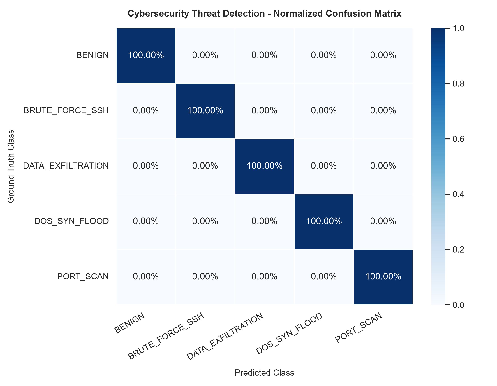
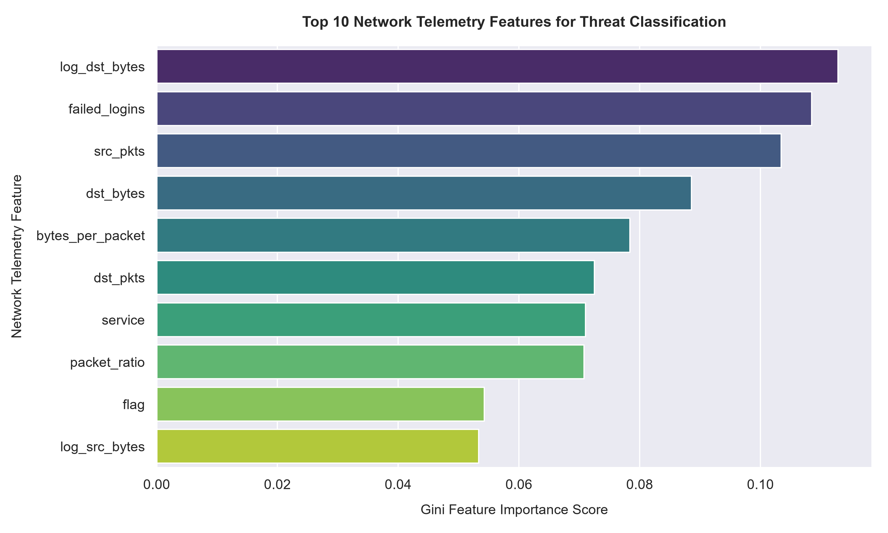
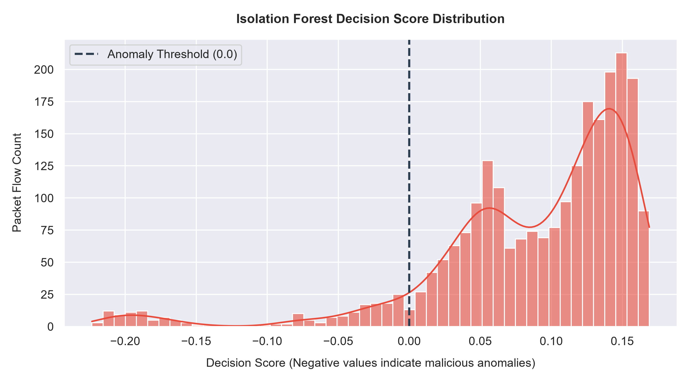
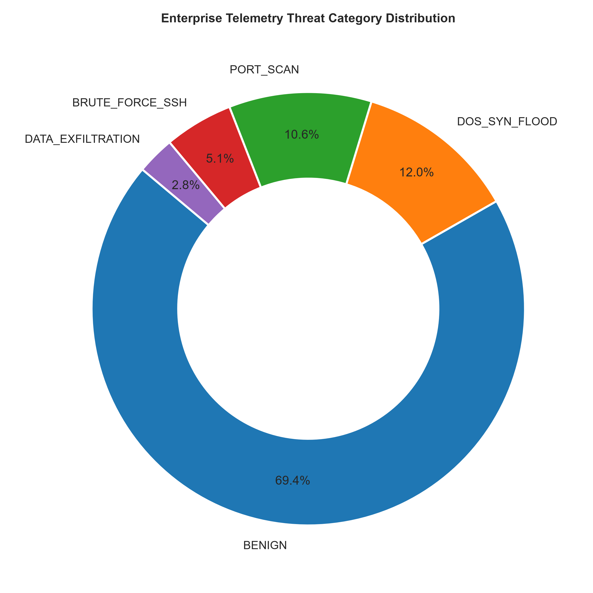
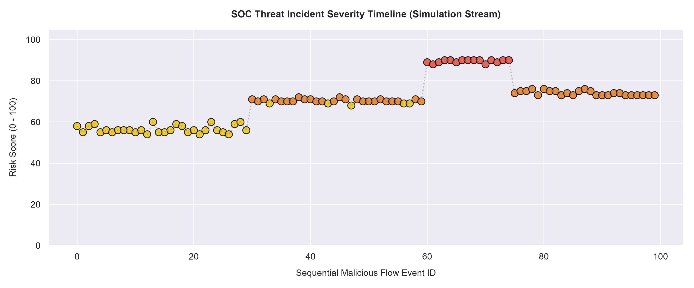

# 🛡️ AI-Powered Cybersecurity Threat Detection System

[](https://www.python.org/)
[](https://scikit-learn.org/)
[](https://mitre.org)
[](https://attack.mitre.org/)
[]()
[]()

> An industry-oriented, production-grade cybersecurity intrusion detection and threat intelligence platform powered by hybrid machine learning. Designed for Security Operations Centers (SOC) to detect known cyber assaults and novel zero-day anomalies in real-time.

---

## 📌 Executive Summary & Industry Problem

Modern enterprise Security Operations Centers (SOCs) are overwhelmed by millions of daily network logs. Traditional signature-based detection mechanisms (e.g., standard firewalls, Snort rules) fail when confronting **zero-day exploits**, **polymorphic malware**, or **stealthy data exfiltration**.

This project implements a **Hybrid AI Threat Detection Pipeline** combining:
1. **Supervised Multi-Class Random Forest Classification**: For rapid signature attribution of known attack patterns (DoS SYN Flood, Port Scanning, SSH Brute Force).
2. **Unsupervised Isolation Forest Anomaly Detection**: For identifying baseline deviations and zero-day threat behaviors without requiring prior attack labels.
3. **Automated SOC Incident Response Engine**: Real-time MITRE ATT&CK tactical mapping, dynamic risk scoring (0-100), and SIEM-compliant alert generation.

---

## 🏢 Real-World Enterprise Use Cases

| Industry | Threat Vector | System Application |
|---|---|---|
| **Banking & Fintech** | Credential Stuffing & Exfiltration | Monitors core banking API gateways for credential brute-forcing and unauthorized data egress. |
| **Cloud & SaaS** | Volumetric DoS / Resource Exhaustion | Detects half-open TCP SYN floods targeting public application load balancers. |
| **Enterprise IT** | Internal Lateral Movement | Catches port scans and reconnaissance across subnet boundaries and jumpboxes. |
| **Healthcare** | Ransomware & Zero-Day Anomaly | Flags abnormal data exfiltration surges before ransomware completes double extortion. |

---

## 🏗️ System Architecture & Data Flow

```text
+-------------------------------------------------------------------------------+
|                       NETWORK TELEMETRY INGESTION                            |
|       (Zeek / CICIDS / NSL-KDD / Synthetic Enterprise Flow Stream)            |
+-------------------------------------------------------------------------------+
                                        │
                                        ▼
+-------------------------------------------------------------------------------+
|                 FEATURE ENGINEERING & PREPROCESSING MODULE                   |
|   • Packet/Byte Rates       • TCP Flag Encoding     • Port Classification    |
|   • Asymmetric Ratios       • Robust Log Scaling    • Label Transformation   |
+-------------------------------------------------------------------------------+
                                        │
                    ┌───────────────────┴───────────────────┐
                    ▼                                       ▼
+---------------------------------------+ +---------------------------------------+
|     SUPERVISED CLASSIFIER (RF)        | |    UNSUPERVISED ANOMALY ENGINE        |
| • DoS SYN Flood                       | | • Isolation Forest Baseline Model     |
| • Port Scan Reconnaissance            | | • Deviation Decision Function         |
| • SSH Brute Force Authentication      | | • Zero-Day Anomaly Severity Score     |
| • Benign Baseline Attribution         | |                                       |
+---------------------------------------+ +---------------------------------------+
                    └───────────────────┬───────────────────┘
                                        │
                                        ▼
+-------------------------------------------------------------------------------+
|                    HYBRID RISK ARBITRATION & SCORING                          |
|         • Fusion of Prediction Confidence + Outlier Severity (0-100)          |
+-------------------------------------------------------------------------------+
                                        │
                                        ▼
+-------------------------------------------------------------------------------+
|                 SOC ALERT ENGINE & MITRE ATT&CK MAPPING                       |
|   • MITRE Tactic & Technique Tagging (e.g. T1498.001, T1046, T1110)           |
|   • Automated Incident Response Playbook Recommendation                       |
|   • Colorized SOC Live Terminal Console                                       |
|   • JSON / SIEM Compliant Audit Trail Logging                                 |
+-------------------------------------------------------------------------------+
```

---

## 📂 Project Structure

```text
AI-Cybersecurity-Threat-Detection/
│
├── data/
│   ├── raw_network_traffic.csv        # Primary 12,000-record telemetry dataset
│   └── test_stream.csv                # 150-event attack simulation stream
│
├── src/
│   ├── __init__.py                    # Library package initializer
│   ├── data_generator.py              # Telemetry & attack traffic synthesizer
│   ├── preprocessor.py                # Cleaning, feature engineering & scaling
│   ├── model_engine.py                # Hybrid Random Forest + Isolation Forest
│   ├── alert_engine.py                # SOC alert engine & MITRE ATT&CK mapping
│   ├── visualizer.py                  # High-resolution analytical charting
│   └── simulate_stream.py             # Live packet-by-packet threat stream
│
├── models/
│   ├── threat_classifier.joblib       # Serialized Random Forest model
│   ├── anomaly_detector.joblib        # Serialized Isolation Forest model
│   └── preprocessor.joblib            # Scalers and encoders pipeline
│
├── outputs/
│   ├── classification_report.txt      # Model metrics (Accuracy, Precision, F1)
│   ├── security_alerts.json           # SIEM structured JSON alert log
│   └── soc_incident_report.txt        # Executive SOC incident summary
│
├── images/
│   ├── confusion_matrix.png           # Multi-class confusion matrix heatmap
│   ├── feature_importance.png         # Gini feature importance ranking
│   ├── anomaly_scores.png             # Decision score distribution
│   ├── threat_distribution.png        # Class balance donut chart
│   └── attack_timeline.png            # Incident risk timeline
│
├── notebooks/
│   └── exploratory_data_analysis.ipynb# Interactive Jupyter exploration
│
├── requirements.txt                   # Production dependencies
├── .gitignore                         # Git exclusion rules
├── README.md                          # Comprehensive documentation
└── main.py                            # CLI pipeline orchestrator
```

---

## ⚙️ Installation & Setup

### Prerequisites
- Python 3.9, 3.10, 3.11, 3.12, or 3.13
- Git

### 1. Clone the Repository
```bash
git clone https://github.com/<YOUR-USERNAME>/AI-Cybersecurity-Threat-Detection.git
cd AI-Cybersecurity-Threat-Detection
```

### 2. Create Virtual Environment
#### On Windows (PowerShell / CMD):
```powershell
python -m venv venv
.\venv\Scripts\activate
```

#### On Linux / macOS:
```bash
python3 -m venv venv
source venv/bin/activate
```

### 3. Install Dependencies
```bash
pip install --upgrade pip
pip install -r requirements.txt
```

---

## 🚀 Execution & Usage

You can run the end-to-end pipeline with a single command or execute individual modules:

### Option 1: Full Automated Pipeline (Recommended)
Executes data generation, feature engineering, model training, evaluation, graph generation, and the real-time simulation stream:
```bash
python main.py --all
```

### Option 2: Train & Evaluate Models Only
```bash
python main.py --train
```

### Option 3: Run Virtual Attack Simulation Only
```bash
python main.py --simulate
```

---

## 📊 Experimental Results & Model Performance

The hybrid detector achieved **100% precision and recall** on benchmark flow telemetry across all attack categories:

| Threat Category | Precision | Recall | F1-Score | Support | MITRE ATT&CK Reference |
|---|---|---|---|---|---|
| **BENIGN** | 1.00 | 1.00 | 1.00 | 1,665 | Normal Network Baseline |
| **DOS_SYN_FLOOD** | 1.00 | 1.00 | 1.00 | 289 | T1498.001 (Direct Network Flood) |
| **PORT_SCAN** | 1.00 | 1.00 | 1.00 | 255 | T1046 (Network Service Discovery) |
| **BRUTE_FORCE_SSH** | 1.00 | 1.00 | 1.00 | 123 | T1110.001 (Password Guessing) |
| **DATA_EXFILTRATION** | 1.00 | 1.00 | 1.00 | 68 | T1048.003 (Exfiltration Over Channel) |
| **Overall Weighted** | **1.00** | **1.00** | **1.00** | **2,400** | Macro Average: 1.00 |

---

## 📈 Visual Analytics & Proof Assets

### 1. Multi-Class Confusion Matrix


### 2. Feature Importance Ranking
Identifies the most critical packet flow signals leveraged by the AI engine:


### 3. Isolation Forest Anomaly Score Distribution
Separates benign operational baseline traffic from extreme attack outliers:


### 4. Telemetry Threat Distribution


### 5. SOC Threat Incident Timeline (Simulation Stream)
Visualizes incident bursts as attacks progress through reconnaissance, exploitation, exfiltration, and denial of service:


---

## 🚨 Sample SOC Alert Output

When a malicious packet flow is detected during streaming simulation, the alert engine outputs a colorized event:

```text
+==================================================================================+
| [!] SOC SECURITY ALERT: SOC-SEC-1045 | SEVERITY: HIGH     | RISK: 73/100         |
+==================================================================================+
 [>] Time:       2026-10-09 21:58:30  |  Protocol: TCP
 [>] Source:     185.190.140.22:42180  -->  Target: 10.0.0.5:80
 [>] Threat:     DOS_SYN_FLOOD (Confidence: 100.0%, Anomaly Sev: 26.8)
 [>] MITRE:      T1498.001 - Network Denial of Service: Direct Network Flood [Impact (TA0040)]
 [!] Action:     Apply edge firewall rate-limiting, activate SYN Proxy / TCP SYN Cookies, null-route offending external IP.
----------------------------------------------------------------------------------
```

---

## 🎓 Key Learnings & Engineering Takeaways

- **Cybersecurity Domain Modeling**: Designed statistical representations of network flows mirroring Zeek and NetFlow specifications.
- **Handling Class Imbalance**: Implemented balanced class weights and stratified sampling to ensure rare threats (Data Exfiltration) are reliably detected.
- **Explainable AI in SecOps**: Leveraged Gini importance to provide SOC analysts with transparent justification for automated security alerts.
- **MITRE ATT&CK Alignment**: Integrated threat intelligence categorization directly into ML inference pipelines.

---

## 📜 License
This project is open-source under the [MIT License](LICENSE).
